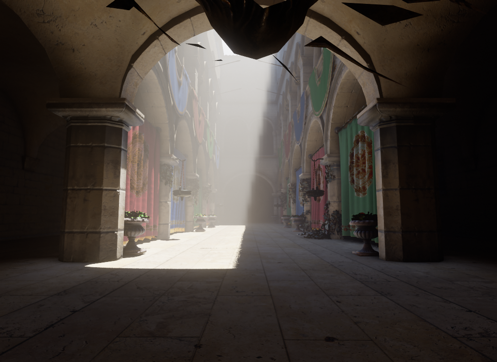
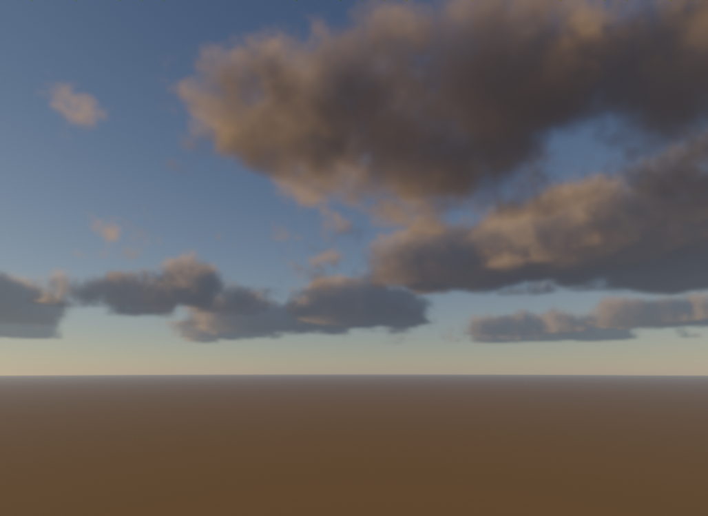

# hyperRender

A real-time rendering framework for C++ and Vulkan, built on NVIDIA's
[Donut](https://github.com/NVIDIA-RTX/Donut) and [NVRHI](https://github.com/NVIDIA-RTX/NVRHI).
Start a rendering idea as a small app and spend your time on what's new in it. The
window, the device, a shader build with hot reload, profiling, deterministic captures,
scene loading and a library of rendering features are already done.



- **A small core** (`hyper/`, about 3,800 lines): the app loop, glTF scenes with texture
  streaming and runtime edits, the scene for ray tracing, compute-pass plumbing, a GPU
  profiler, shader hot reload and image captures.
- **20 opt-in modules** (`modules/`), each its own library. An app links the ones it
  uses, and what it doesn't link isn't built.
- **No floor.** Every layer below stays reachable on the same device and command list:
  Donut's passes, NVRHI, and raw Vulkan.
- **Tested by images.** Every example renders fixed frames that are compared with
  reference images, and any Vulkan validation message fails the run.

> **Status: 0.1.0, early.** Windows and Vulkan only (D3D12 builds but is untested). The
> API can still change before 1.0. See the [changelog](CHANGELOG.md).

## Requirements

- Windows 10 or 11, 64-bit.
- A GPU with Vulkan 1.3. Ray tracing and mesh shaders are used when the GPU has them
  (NVIDIA RTX 20-series or newer, AMD RX 6000 or newer). Without them, the ray-traced
  modules switch themselves off.
- Visual Studio 2026 with the "Desktop development with C++" workload. Visual Studio
  2022 has a preset too, but hasn't been tested yet.
- [CMake](https://cmake.org/download/) 3.28 or newer.
- The [Vulkan SDK](https://vulkan.lunarg.com/sdk/home#windows) (for the validation layers
  and the DXC shader compiler).
- Git, and PowerShell 7 (`pwsh`) and Python 3 for the tools.

## Quick start

```powershell
git clone --recursive https://github.com/mathiassol/hyperRender.git
cd hyperRender
cmake --preset vs2026
cmake --build --preset vs2026-release
build\vs2026\bin\hello.exe
```

`hello` and `clouds` need no downloads. For the `scene` example, fetch the test scenes
first (about 60 MB of glTF sample models from Khronos and an HDRI from Poly Haven):

```powershell
pwsh tools/fetch_assets.ps1
build\vs2026\bin\scene.exe
```

Hold the left mouse button and drag to look; WASD moves, Q / E go down / up, Shift is
faster. F1 hides the UI, F12 saves a screenshot.

`vs2026-debug` builds `<app>-debug.exe` with the Vulkan validation layers on. Use it while
developing, and the release build for timings. [Getting started](docs/getting-started.md)
covers the setup in detail.

## Your first app

An app is a class that derives from `hyper::App`:

```cpp
#include <hyper/hyper.h>
#include <hyper/passes/PostProcess.h>

class MyApp : public hyper::App
{
public:
    explicit MyApp(hyper::Context& ctx) : App(ctx), m_Post(ctx) { }

    bool Init() override
    {
        m_CommandList = Ctx().device->createCommandList();
        return true;
    }

    void Render(nvrhi::IFramebuffer* framebuffer) override
    {
        // ... draw into an HDR texture, then tone-map it into the framebuffer with m_Post
    }

private:
    hyper::PostProcess m_Post;
    nvrhi::CommandListHandle m_CommandList;
};

int main(int argc, const char* const* argv)
{
    hyper::AppDesc desc;
    desc.title = "my app";
    desc.shaderDir = "myapp";
    return hyper::Run<MyApp>(argc, argv, desc);
}
```

```cmake
add_executable(myapp main.cpp)
target_link_libraries(myapp PRIVATE hyper::hyper hyper::post)
hyper_app(myapp)
hyper_add_shaders(myapp CONFIG "${CMAKE_CURRENT_SOURCE_DIR}/shaders/shaders.cfg" NAME myapp)
```

[Writing an app](docs/writing-an-app.md) walks through a complete one: shaders, passes,
the UI, settings from the command line, and captures. `apps/hello` is a working app to
copy.

## Use it in your own project

Add hyperRender as a submodule and pull it in with `add_subdirectory`. You get the
libraries and the CMake helpers, and the examples stay out of your build:

```cmake
cmake_minimum_required(VERSION 3.28)
project(myproject LANGUAGES C CXX)
add_subdirectory(external/hyperRender)

add_executable(myapp main.cpp)
target_link_libraries(myapp PRIVATE hyper::hyper hyper::post hyper::gpu hyper::ddgi)
hyper_app(myapp)
```

See [Using hyperRender in your project](docs/using-in-your-project.md).

## Modules

| Module | What it does | Built on |
|---|---|---|
| `post` | TAA, bloom, auto exposure, AgX and other tone curves, film grain, overlays | |
| `gpu` | GPU-driven G-buffer and shadows: GPU culling, two-phase Hi-Z, indirect draws; meshlets and cluster LOD; incremental scene edits | |
| `shadows` | cascaded sun shadows | `gpu` |
| `atmosphere` | physically based sky (Hillaire 2020), sun colour, aerial perspective | |
| `environment` | IBL probe from a sky capture or an HDR image | |
| `ao` | ground-truth ambient occlusion (XeGTAO) with multi-bounce | |
| `ssr` | Hi-Z screen-space reflections with a temporal resolve | |
| `traced` | ray-traced bounce light and reflections; the app writes what a ray sees | |
| `rtlighting` | how ray hits are lit: sun, environment, a probe volume or the IBL probe | |
| `rtshadows` | ray-traced soft sun shadows | |
| `rtreflections` | ray-traced reflections | `rtlighting` |
| `ddgi` | probe-volume global illumination | `rtlighting` |
| `reference` | ground-truth path tracer | `rtlighting` |
| `noise` | baked 3D noise volumes | |
| `fog` | froxel volumetric fog | `noise`, `rtlighting` |
| `volumes` | ray-marched media and a cloud layer | `noise` |
| `ocean` | FFT ocean: cascaded spectra, foam, a clipmap surface | |
| `atmospheres` | planets' atmospheres from what they're made of, seen from anywhere | |
| `planet` | planets' ground: a cube-sphere quadtree from one CPU/GPU height function | |
| `debugview` | shows any texture or channel over the frame | |

Each module is described in [Modules](docs/modules.md): its settings, how to wire it in,
and what it costs.

## Examples

| Example | What it shows |
|---|---|
| `apps/hello` | every layer in one file: a raw Vulkan query, an NVRHI compute pipeline tracing a small scene, `post` on top, profiling and hot reload |
| `apps/clouds` | the atmosphere, the IBL probe and the cloud layer, with no scene |
| `apps/scene` | any glTF through most modules: a full deferred frame, with ray-traced shadows, reflections, DDGI and fog, or the reference path tracer. The example to copy a frame from |



## Documentation

- [Getting started](docs/getting-started.md): setup, building, running the examples.
- [Writing an app](docs/writing-an-app.md): the app class, shaders, passes, the UI,
  captures.
- [Using hyperRender in your project](docs/using-in-your-project.md): as a submodule.
- [Architecture](docs/architecture.md): the layers, the core, binding slots, scenes and
  rays, Donut workarounds, pitfalls.
- [Modules](docs/modules.md): every module in detail.
- [Testing](docs/testing.md): captures and the image regression suite.
- [Contributing](CONTRIBUTING.md).

## License

MIT, see [LICENSE](LICENSE). hyperRender builds on Donut, NVRHI and other open-source
projects under their own licenses: [THIRD_PARTY_NOTICES.md](THIRD_PARTY_NOTICES.md).
