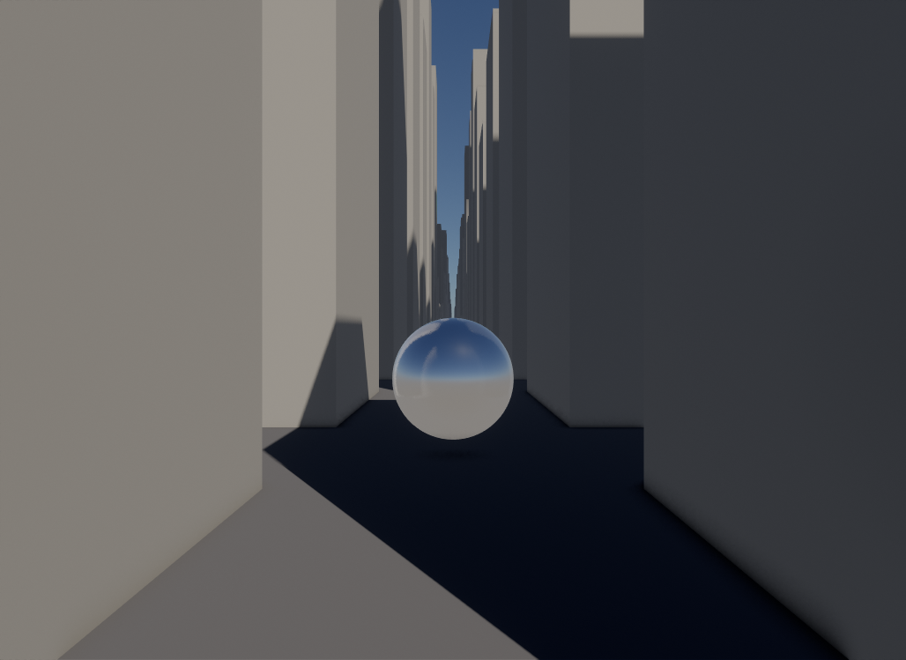
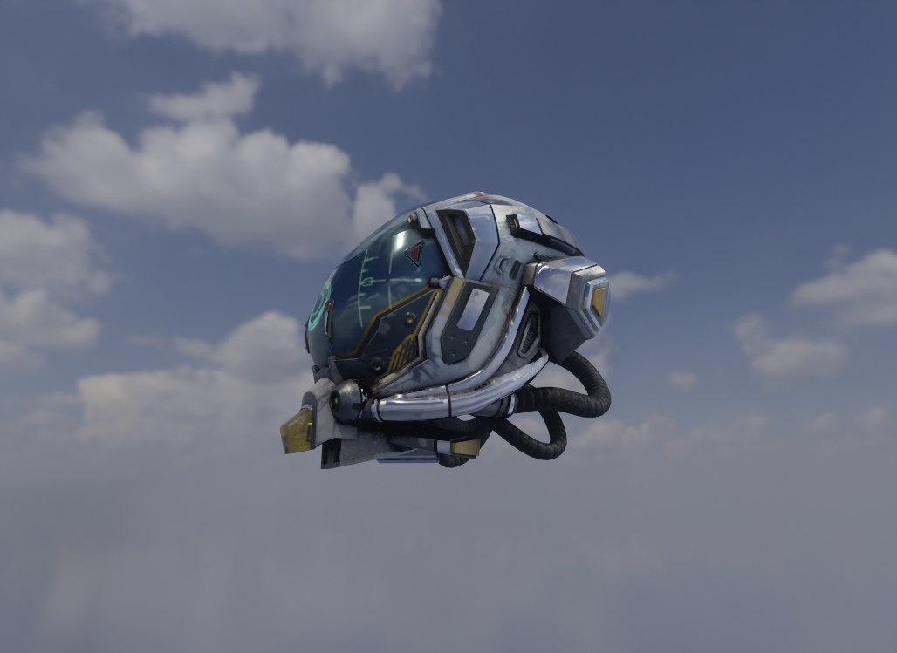
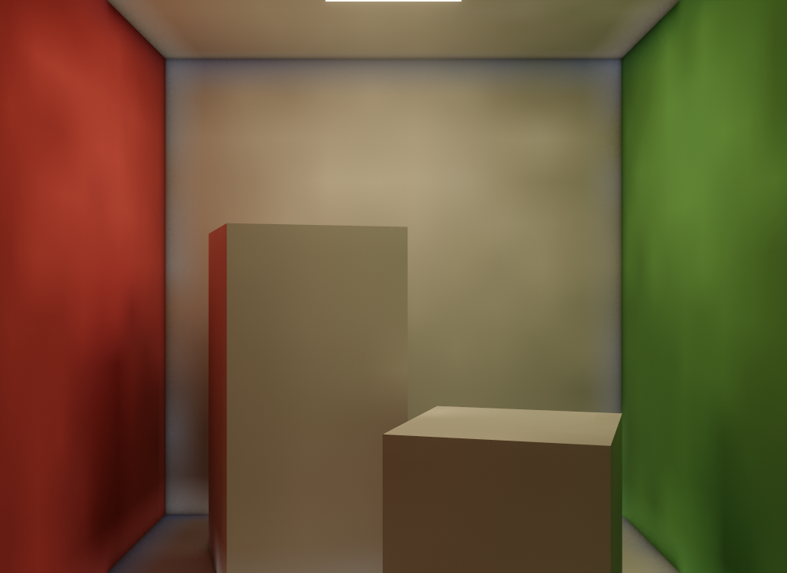
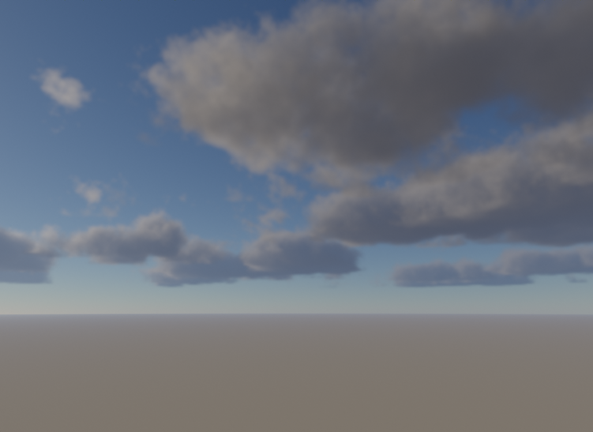

# Modules

20 modules, about 13,000 lines. Each is `modules/<name>/` with `include/`, `src/` and
`shaders/`, a static library `hyper::<name>` declared in `modules/CMakeLists.txt` with
the modules it depends on. Link the ones you use; the rest aren't built. Timings are
Release builds at 1028×749 on an RTX 3070 Ti; costs are for Sponza unless stated.

```
post  debugview  gpu ← shadows  ao  atmosphere  environment  ssr  traced
rtlighting ← rtreflections, ddgi, reference, fog      noise ← fog, volumes      rtshadows
ocean  atmospheres  planet
```

Modules follow one shape: a `settings` struct with `BuildUI()`, `CreatePipelines()`, a
`Render` (or similar) taking a small `Inputs` struct. **Off costs nothing**: a module
builds its pipelines and size-dependent resources on first use, does no work while
disabled, and `CreatePipelines()` does nothing before its first use. Constructing all of
`apps/scene`'s modules takes 3.7 ms; with every one switched off (`scene-off`) only
Donut's passes and `post` draw. `apps/scene/SceneRenderer.cpp` wires most of them into
one deferred frame: read it alongside this page.

### post: `PostProcess`, `Bloom`, `Tonemap`
- Donut's TAA (upscales when the input is smaller) → mip-chain bloom (Jimenez 2014) →
  Donut's exposure histogram → tone curve (AgX by default; ACES fitted, Khronos Neutral,
  Reinhard, clamp) → a look (a power and a saturation on the curve's output, as Blender's
  AgX looks; none by default), dither, film grain. `Inputs::overlay` is added after TAA, for things
  reprojection would smear.
- `PrepareView(view)` before drawing (it jitters the view for TAA), `Render(cmd, { color,
  depth, motionVectors }, view, target)` after.
- 0.19 ms (TAA 0.07, bloom 0.06, tone map 0.06).

### gpu: `GpuDrivenRenderer`, `GpuScene`
- `GpuScene` copies the scene's opaque and alpha-tested geometry into shared buffers
  (sub-allocated by `GpuArena`) with a record per geometry and per draw. Edits are
  incremental: meshes nothing draws give their ranges back; new meshes are copied and
  split on their own the frame after Donut uploads them; buffers grow, keeping their
  contents; only the draw list is rewritten.
- `GpuDrivenRenderer` culls per draw on the GPU (frustum, two-phase Hi-Z occlusion for
  the camera), then draws the G-buffer and the shadow cascades with indirect-count draws
  and vertex pulling. Opt-in: meshlets (task + mesh shaders, culled by frustum, normal
  cone and Hi-Z) and cluster LOD (meshoptimizer's `clusterlod`: a DAG of simplified
  clusters, cut per view at `lodErrorPixels`).
- `BeginFrame(cmd, scene)` once, then `RenderGBuffer(...)`, which falls back to Donut's
  CPU-driven pass itself when GPU-driven drawing is off or unavailable.
- G-buffer 0.31 ms. The 20,001-instance stress city: 6.4× less GPU time and 19× less CPU
  time than Donut's passes (measured in one session, 2026-10-04). 133M triangles of
  spheres with cluster LOD: 1.99 ms a frame. Adding an instance of a loaded mesh: 0.06 ms.


- Limits: blended and transmissive geometry stays on Donut's forward pass (the app draws
  it); ray tracing sees full-detail meshes, not the LOD cut; building the LOD DAG takes
  about 0.6 s for Sponza at load; the draw list is rewritten whole on every edit (about
  1 ms at 1,700 instances).

### shadows: `SunShadows` (built on gpu)
- Donut's cascaded shadow map: 4 stable cascades of 2048², drawn by `gpu` when given,
  else by Donut's depth pass. 0.25 ms.

### atmosphere: `Atmosphere`
- Hillaire 2020: transmittance, multiple-scattering and sky-view LUTs, an
  aerial-perspective volume. Gives the sun its colour (`SunTransmittance`), draws the
  sky, applies aerial perspective, captures the sky into a cubemap for `environment`.
- 0.06 ms with sky and aerial perspective.

### atmospheres: `PlanetAtmospheres`
- Planets' atmospheres seen from anywhere (space, the limb, the ground), derived from what
  they're made of rather than tuned. Not `atmosphere`, which is an Earth sky over a flat
  scene. For space or planet-scale apps.
- `atmosphere::Rayleigh` (a gas mix: each gas's refractivity and King factor at P / kT),
  `atmosphere::Mie` (BHMIE over a Hansen–Travis size distribution) and `atmosphere::Ozone`
  (a column as a tent) give the coefficients at 612, 549 and 465 nm.
- `Add(parameters)` builds Hillaire 2020's tables on the CPU (transmittance, multiple
  scattering, the sky's irradiance on the ground) into one slice of each texture array, up
  to 4. `Prepare(cmd)` uploads, first in the frame. `Render(cmd, view, hdr, depth,
  constants, count)` marches every pixel's view ray (32 steps) through each atmosphere,
  farthest first, over an exposed camera-relative HDR image. An occluder sphere per
  atmosphere darkens the air in an eclipse's shadow.
- The CPU side marches the same way: `Transmittance`, `Irradiance` and `Radiance` for an
  app's exposure, and `GeometricAlbedo` / `FitGroundAlbedo` for the ground under the air
  that gives a planet its measured brightness.
- Shaders that light ground under an atmosphere include `hyper/planet_atmosphere.hlsli`
  and bind `TransmittanceTexture()` and `IrradianceTexture()`.
- 0.93 ms under Earth's noon sky at 1028×749, 0.16 ms for Earth seen from orbit.

### planet: `PlanetTerrain`
- Planets' ground, for space or planet-scale apps: each body a cube-sphere quadtree of
  65 × 65-vertex tiles made on the GPU, from one height and material function
  (`hyper/planet_terrain.h`) that C++ and HLSL both compile: `HeightAt` on the CPU is the
  ground drawn. A body is a `PlanetTerrainConstants` (shape, craters, temperatures and the
  materials' albedos); `terrain::Calibrate` scales a generated shape to a topographic range
  and puts the sea at its ocean fraction. `AddMap` registers a measured elevation map
  (1440 × 720); a body on one is the map, generated only finer than its cells. `AddPatch`
  registers a finer map over a latitude-longitude box (a body's `patchFirst`,
  `patchCount`): patches nest, coarse first, each faded over what's under it, and each has
  mip levels a tile reads by its vertices' spacing. Shaders that walk the ground bind
  `MapsTexture()`, `PatchesBuffer()` and `PatchSamplesBuffer()` and define
  `TERRAIN_MAP_LOAD`, `TERRAIN_PATCH` and `TERRAIN_PATCH_LOAD`.
- `Render(cmd, view, gbuffer, views, placements)`: walks each body's quadtree from the
  camera (horizon and frustum culling against each tile's own sampled heights, split by
  quad size on screen), makes the tiles it lacks coarse first within `tilesPerFrame` in
  one dispatch, and draws them instanced into the G-buffer. Positions are camera-relative:
  each tile's centre from doubles, each vertex a small offset from it, so the ground is
  exact metres away on an Earth.
- `hyper/planet_shadow.hlsli`: a shader's march to a star through the same function, for
  the ground's own shadows.
- 0.27 ms on the ground at noon, 0.05 ms from orbit; a descent from 2,000 km to 2 m never
  exceeds 4 ms a frame.

### environment: `EnvironmentLighting`
- An IBL probe (diffuse 16², specular 128² × 6 mips, BRDF LUT) from a sky capture or an
  equirectangular HDR file. The sky is any `SkyCapture` (a render callback and a revision;
  the atmosphere's, or Donut's procedural sky).
- Captures only when the sun, sky or source changes: about 6.2 ms GPU and 3.3 ms CPU.
- Its cubemaps (about 23 MB) and Donut's probe passes are made on the first `Update`
  with it enabled: `EnvironmentMap()` is null until then.



### ao: `AmbientOcclusion`
- XeGTAO (vendored, MIT, `modules/ao/thirdparty/`), high quality, two denoise passes.
  Its tuning reaches the shader (`XE_GTAO_USE_DEFAULT_CONSTANTS 0`): thin-occluder
  compensation 0.5 by default, so foliage isn't speckled black. With the G-buffer's albedo
  (`Render(..., albedo)`), multi-bounce (Jimenez et al. 2016) lightens bright surfaces'
  occlusion. 0.15 ms.

### ssr: `ScreenSpaceReflections`
- Hi-Z-traced reflections with a temporal resolve and the IBL probe as fallback; it also
  finishes `rtreflections`' rays. 0.39 ms with its Hi-Z.

### traced: `TracedLighting`
- Ray-traced one-bounce diffuse light at half resolution (temporal + three à-trous
  passes) and GGX reflections (one ray per pixel, one in four where rough; history
  reprojected through the reflected point; a roughness-scaled blur), on the app's
  `ComputePasses`.
- What a ray sees is the app's: it compiles `hyper/traced_lighting.hlsli` in its own
  shader set and defines `TraceDiffuse`, `ReflectingSurface` and `TraceReflection`.
  `settings`: bounce rays per pixel, clamps against fireflies, the depth tolerance its
  filters accept (`BuildUI()` shows them).
- About 0.9 ms for bounce light and 0.9 ms for reflections in a dense night street scene.

### rtlighting: `RtLighting`
- How ray hits are lit (`hyper/rt_lighting.hlsli`): the sun with a shadow ray, the
  environment for misses, and indirect light from a probe volume when one is handed
  over (`RtProbeVolume`, which `ddgi` fills in), else from the IBL probe. `Prepare(...)`
  once a frame before any ray pass. No settings; constants only.

### rtshadows: `RtShadows`
- Soft sun shadows, one ray per pixel towards a point of the sun's disk; TAA resolves
  the noise. Replaces the cascades where enabled. 0.08 ms.

### rtreflections: `RtReflections` (built on rtlighting)
- One ray per pixel, hits shaded with `RtLighting`; `ssr`'s temporal resolve and composite
  finish them (the app wires the two). 0.30 ms + 0.07 ms resolve.

### ddgi: `Ddgi` (built on rtlighting)
- Probe-volume GI (Majercik et al. 2019): a grid over the scene's bounds (4,096 probes by
  default), 128 rays per probe per frame, octahedral irradiance and distance atlases,
  probe relocation. `Gather` turns it into the deferred pass's indirect light, with the
  IBL's specular occluded by it. Its volume lights every other ray pass's hits through
  `RtLighting`.
- 0.74 ms update + 0.14 ms gather. Converges over about 100 frames.
- Limits: diffuse only, low frequency (thin walls can leak); reallocates on a new scene,
  not on edits.



### reference: `ReferencePathTracer` (built on rtlighting)
- Ground truth: camera paths with Donut's BSDF, the sun as a disk with MIS, the
  environment for misses, Russian roulette after 3 bounces (8 by default), accumulated
  while nothing changes. 2.9 ms per sample per pixel in Sponza; 2,048 samples converge.
- Not modelled: point and spot lights, transmission, fog, volumes, aerial perspective.

### noise: `NoiseVolume`
- Bakes tileable 3D noise on the GPU: gradient (R16F), Perlin-Worley and Worley fbm
  (RGBA8). Functions in `hyper/noise.hlsli`.

### fog: `VolumetricFog` (built on noise, rtlighting)
- Froxels (8 × 8 pixels × 64 exponential slices to 64 units): height fog, noise, up to 8
  local boxes or spheres; lit by the sun (shadowed by rays with `RtLighting`, else by the
  cascades), point and spot lights (unshadowed) and ambient; reprojected over time.
  0.30 ms.

### volumes: `RaymarchedVolumes` (built on noise)
- Half-resolution jittered march with temporal accumulation for media volumes (noisy,
  optionally emissive boxes and spheres) and a cloud layer (coverage map, Perlin-Worley
  shape, Worley erosion, Beer-powder, dual-lobe phase, multiple-scattering octaves,
  self-shadowing). Takes the sun as values and the aerial perspective as a texture.
- A smoke ball in Sponza 0.18 ms; the clouds app's sky 0.82 ms.
- Limits: the cloud layer is flat (no planet curvature) and doesn't shadow the ground;
  media don't shadow the scene.



### ocean: `Ocean`
- An FFT ocean (Tessendorf): a JONSWAP spectrum with Donelan-Banner spreading and a
  swell, built on the CPU in three cascades (400, 61 and 9.7 m patches, each its own band
  of wavelengths); each frame the spectrum evolved, inverse-FFT'd in groupshared memory
  and assembled into displacement, foam (where the surface's Jacobian folds) and slopes
  with their squares (LEAN: roughness grows with distance). Drawn as an instanced
  clipmap around the camera (128² cells a level, crack-free morphing, planet curvature,
  past the horizon) into the standard G-buffer, so every lighting module treats it as a
  surface; its own shading is crest scattering (emissive) and foam.
- `HeightAt(xz, time)`: the long waves' height on the CPU, exact and without latency, for
  what floats.
- 0.10 ms for the simulation, 0.09 ms for the surface (1028×749), from 5 m or 300 m up.
- Limits: opaque water (no refraction, the camera stays above it); not in the
  ray-tracing scene; no wakes or contact foam.

### debugview: `DebugView`
- Draws any texture or channel (colour, red, alpha, normals) over the frame, for
  inspecting intermediates.
